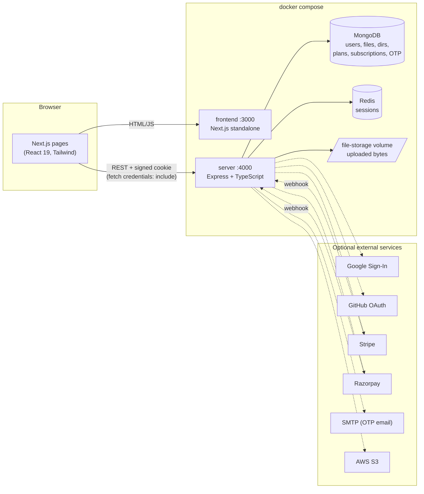
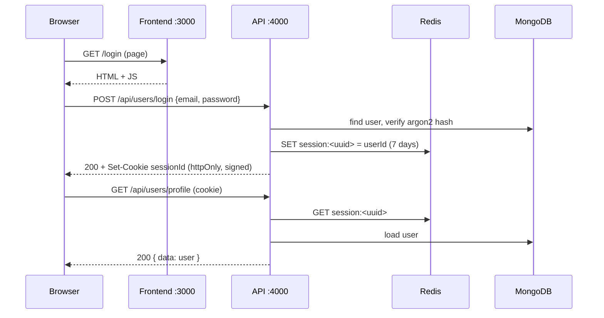
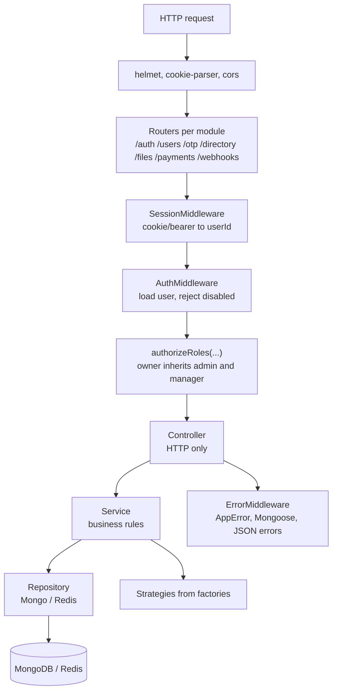
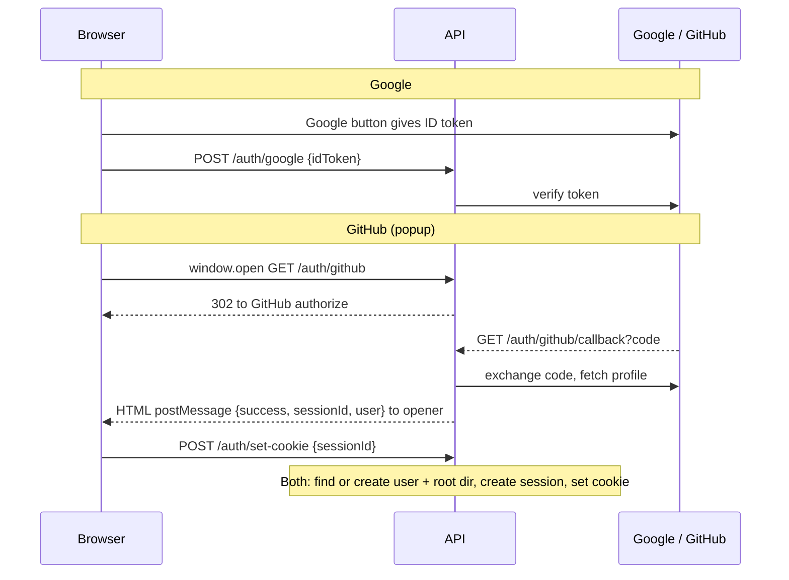
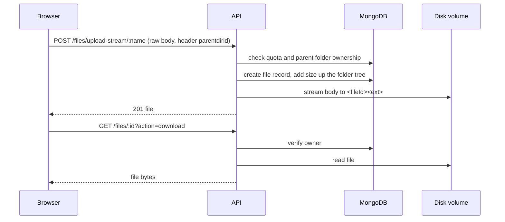
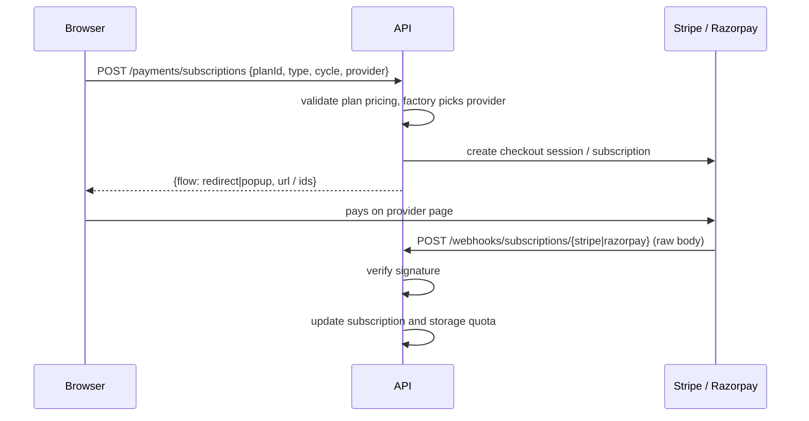
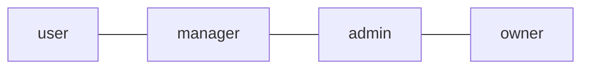

# DevDrive – Architecture & Flows

## 1. System overview (Docker Compose)



## 2. How the client and backend connect

- The browser loads pages from the **frontend** (port 3000) and then calls the **API directly** at `NEXT_PUBLIC_API_URL` (default `http://localhost:4000/api`). The frontend server never proxies API calls.
- All calls go through one class, `ApiService` (`frontend/src/services/api.service.ts`), using `fetch(..., { credentials: 'include' })`. File uploads use `XMLHttpRequest` so the progress bar works.
- Login sets an **HTTP-only, signed `sessionId` cookie**. The browser sends it automatically on every call. The API also accepts `Authorization: Bearer <sessionId>`.
- **CORS** allows only the origins in `CORS_ORIGINS` (the frontend URL) with credentials.
- `AuthContext` calls `GET /users/profile` on page load to find out who is signed in, and every page redirects or hides content based on that user and role.



## 3. Backend architecture (layers and patterns)



### Composition root and design patterns

```mermaid
classDiagram
    class AppContainer {
        +constructor(overrides)
        wires repositories, services, controllers
    }
    class ISessionRepository
    class RedisSessionRepository
    class InMemorySessionRepository
    ISessionRepository <|.. RedisSessionRepository
    ISessionRepository <|.. InMemorySessionRepository
    class SessionRepositoryFactory

    class OAuthProvider {
        <<abstract>>
        +authenticate(credential)
    }
    class GoogleOAuthProvider
    class GithubOAuthProvider
    OAuthProvider <|-- GoogleOAuthProvider
    OAuthProvider <|-- GithubOAuthProvider
    class OAuthProviderFactory

    class PaymentProvider {
        <<abstract>>
        +createSubscription()
        +createOneTimePayment()
    }
    class StripeProvider
    class RazorpayProvider
    PaymentProvider <|-- StripeProvider
    PaymentProvider <|-- RazorpayProvider
    class PaymentProviderFactory

    class IFileStorage
    class LocalDiskStorage
    class IUploadUrlSigner
    class S3UploadUrlSigner
    IFileStorage <|.. LocalDiskStorage
    IUploadUrlSigner <|.. S3UploadUrlSigner
    class StorageFactory

    AppContainer --> SessionRepositoryFactory
    AppContainer --> OAuthProviderFactory
    AppContainer --> PaymentProviderFactory
    AppContainer --> StorageFactory
```



| Principle / pattern | Where |
|---|---|
| Dependency injection (constructor) | `container.ts` is the only place concrete classes are created |
| Strategy | session store, OAuth provider, payment provider, file storage |
| Factory | `factories/*.factory.ts` choose a strategy from config |
| Repository | `*.repository.ts` isolate Mongo/Redis from business logic |
| Interface segregation / DIP | services depend on `IUserRepository`, `ISessionService`, `IFileStorage`, ... |
| Single responsibility | controller (HTTP) → service (rules) → repository (data) |

## 4. Key flows

### 4.1 OAuth login (Google and GitHub)



### 4.2 File upload and download



The upload route skips the JSON body parser, so files of any type (including `.json`) are stored byte for byte. If `S3_BUCKET` is set, `POST /files/presigned-url` returns a signed S3 upload URL instead.

### 4.3 Payments and webhooks



### 4.4 Role-based administration



| Action | manager | admin | owner |
|---|---|---|---|
| List all / active / disabled users | yes | yes | yes |
| Change a role | user and manager targets only, cannot grant admin/owner | cannot touch admin/owner accounts | any |
| Soft delete / recover | no | yes (not another admin or owner) | yes (not an owner) |
| Hard delete | no | no | yes (not an owner) |

Disabled users are blocked at login and on every request.

## 5. Features

| Area | Features |
|---|---|
| Accounts | Email/password register and login, Google and GitHub sign-in, set password for OAuth users, optional email OTP check |
| Sessions | Signed HTTP-only cookie, Redis (or in-memory) store, logout, logout from all devices |
| Drive | Nested folders, upload with progress, download, rename, recursive delete, per-folder size totals, storage quota and usage |
| Access control | Four roles (user, manager, admin, owner), soft and hard delete, recover, role changes with hierarchy rules |
| Billing | Plans, one-time and subscription pricing, Stripe and Razorpay checkout, webhook verification |
| Platform | Helmet, CORS, central error handling, health check, Docker Compose deployment |
| UI | Design-token theme, reusable UI components, responsive navbar, toasts, confirm dialogs |

## 6. Repository layout

```text
DevDrive/
├─ docker-compose.yml        mongo + redis + server + frontend
├─ server/
│  ├─ src/
│  │  ├─ server.ts           startup and graceful shutdown
│  │  ├─ app.ts              middleware and routers
│  │  ├─ container.ts        dependency wiring
│  │  ├─ modules/            auth, user, otp, directory, file, payment, session, webhook
│  │  ├─ factories/          session, oauth, payment, storage
│  │  ├─ providers/          oauth, payment, storage strategies
│  │  ├─ middlewares/        session, auth, roles, errors
│  │  ├─ models/             Mongoose schemas
│  │  └─ shared/             env, errors, types, helpers
│  └─ test/                  unit and integration tests (56)
└─ frontend/
   └─ src/
      ├─ app/                pages: /, login, register, profile, pricing, admin/users
      ├─ components/         Navbar, AuthShell, ui/ design system
      ├─ context/            AuthContext
      ├─ services/           ApiService (all REST calls)
      └─ lib/ types/         helpers and shared types
```
